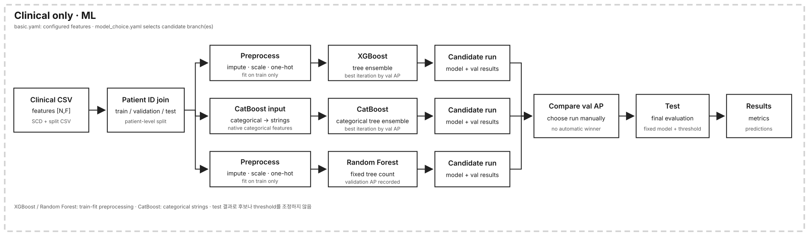
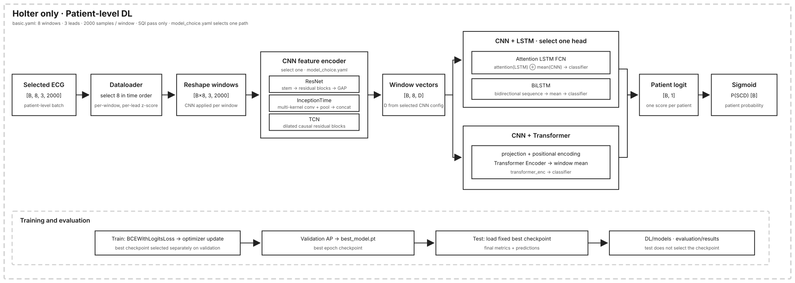
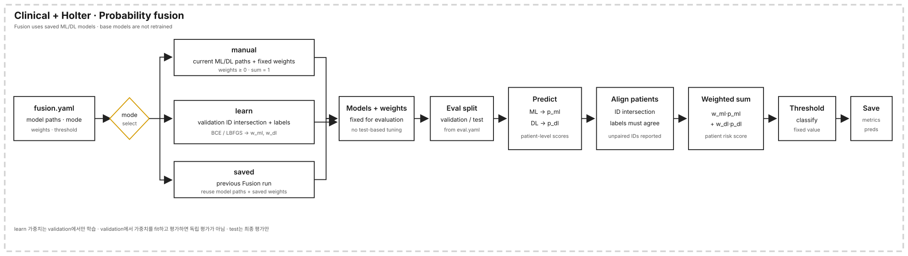

# SCD 실험 순서도

상세 실행 방법은 [TRAINING_GUIDE.md](TRAINING_GUIDE.md)를 참고하세요. 아래 그림은 참고 예시처럼 박스와 연결선으로 입력 형태, 모델 분기, 출력 흐름을 보여줍니다.

## 임상 데이터만 사용하는 ML

전처리와 XGBoost·CatBoost·Random Forest의 분기를 한 그림에서 비교합니다. XGBoost와 CatBoost는 validation AP로 best iteration을 고르고, Random Forest는 설정된 tree 수를 사용합니다. 후보 run 중 평가할 모델은 validation 결과를 보고 지정합니다.

## Holter 데이터만 사용하는 DL

입력 tensor shape과 CNN 내부 요약, sequence head 분기를 나타냅니다. 실제 dataloader는 sidecar에서 `sqi_pass=1`인 window를 골라 정규화합니다. 설정에서 CNN 하나와 `CNN+LSTM` 또는 `CNN+Transformer` 조합을 고릅니다. validation AP가 best checkpoint를 고르고 test는 고정 checkpoint의 최종 평가에 사용됩니다.

## 임상 + Holter 결합

저장된 ML/DL 모델의 환자별 확률을 맞춰 가중 결합하는 구조입니다. `manual`, validation으로 학습하는 `learn`, 이전 run을 재사용하는 `saved` 모드를 표시했습니다. 최종 test 결과로 가중치나 threshold를 조정하지 않습니다.
