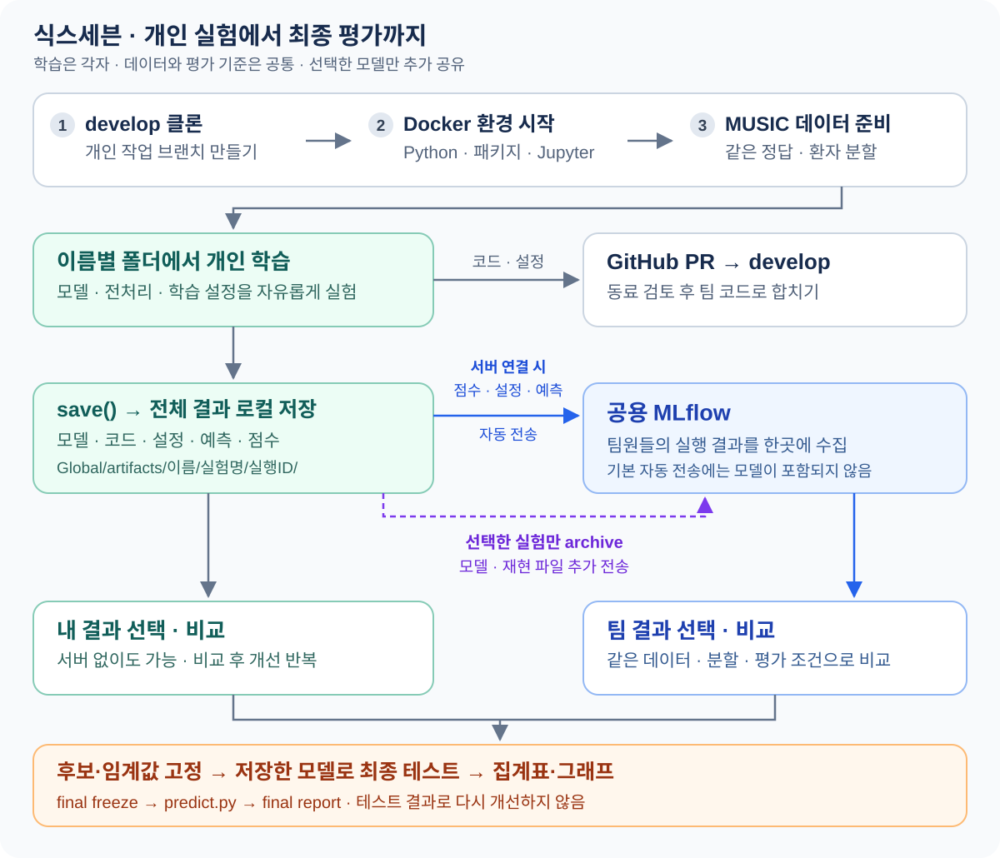

# 식스세븐 | 식스레터스 기업 연계 PoC

공통 데이터로 각자 모델을 학습한다. **코드·설정은 GitHub, 실행 결과는 MLflow로 공유한다.**

<details>
<summary>전체 흐름 보기</summary>



</details>

## 1. 저장소와 실행 환경 준비

Windows는 **WSL2 Ubuntu·Git·Docker Compose 2.40.3 이상**을 준비한다. [설치·접근 확인](Global/docs/development.md#1-wsl2와-docker-확인)

아래 명령은 **Ubuntu 터미널**에서 실행한다. macOS는 macOS 터미널과 CPU 환경을 사용한다. `yourname`·`이슈번호`·이메일은 본인 값으로 바꾼다. JupyterLab의 **Launcher → Terminal**에서는 `./dev` 대신 `dev`로 데이터 준비·학습·비교를 실행한다. 별도 가상환경 활성화는 필요 없다.

```sh
mkdir -p ~/projects
cd ~/projects
git clone --branch develop https://github.com/team-sixseven/sixletters-poc.git
cd sixletters-poc
```

GitHub **Issues → New issue**에 실험 목표를 적고, 발급된 번호로 브랜치를 만든다.

```sh
git switch -c experiment/이슈번호-clinical-baseline
git config --local user.name "본인 이름"
git config --local user.email "GitHub에 등록한 이메일"
./dev hooks
```

**같은 터미널에서 환경 시작**

```sh
./dev up -d --wait
./dev url
```

환경 점검이 끝나면 터미널이 돌아온다. `url`에 표시된 토큰으로 `http://localhost:8888`의 JupyterLab에 접속한다. GPU는 [GPU 준비](Global/docs/development.md#2-nvidia-gpu-사용) 후 `./dev up --gpu -d --wait`로 시작한다. CPU·GPU는 하나만 켠다. 막히면 `./dev status`로 상태와 다음 작업을 확인한다.

## 2. MUSIC 준비와 사전 실습

처음 한 번 데이터와 개인 ID를 등록한다. `yourname`은 **팀원과 중복되지 않는 영문 소문자 ID**로 바꾼다. 공백 없이 정하고 프로젝트 동안 같은 값을 사용한다. 이 ID가 개인 폴더와 실험 작성자에 쓰이며, Git의 `user.name`과 같을 필요는 없다.

```sh
./dev music
./dev init --owner "yourname"
```

`init`의 데이터 경로는 표시된 기본값을 확인하고 Enter를 누른다. `Local settings saved`가 나오면 완료다. CSV 3개만 내려받으며 **공통 데이터·정답·환자 분할은 직접 바꾸지 않는다.** [데이터 기준](Global/data/README.md)

사전 실습은 다음 명령으로 만든다.

```sh
./dev practice
```

JupyterLab에서 `Members/yourname/notebooks/01_music_practice.ipynb`를 열어 **Run → Run All Cells**를 실행한다. 이 노트북은 CSV 확인·기본 모델·평가지표 실습용이며 MLflow에 자동 등록되지 않는다.

## 3. 개인 학습과 결과 비교

```sh
./dev new exp001 --feature-set clinical
./dev exec exp001 train.py
```

`Members/yourname/experiments/exp001/`에 기본 모델 예제가 생긴다. 추가 패키지가 없으면 **설치된 공통 환경으로 바로 실행**한다. 개인 패키지를 추가해도 공통 패키지는 재사용하며, 공통에 없는 패키지만 개인 환경에 설치한다. **예제는 `Experiment.save()`까지 호출한다.** 직접 만든 학습 코드도 이 호출을 포함해야 결과가 저장된다.

`Validation results saved:`가 나오면 `Global/artifacts/yourname/exp001/실행ID/`에 저장된 것이다. 매 실행은 별도로 보관된다.

첫 학습이 끝나면 실험 폴더의 `config.toml`에서 `[parameters]` 아래 **`C`의 값만 `1.0`에서 `0.1`로 바꾸고 저장**한 뒤 다시 실행한다. 복제한 설정의 `"C"`도 같은 항목이므로 키의 따옴표는 그대로 둔다.

```sh
./dev exec exp001 train.py
./dev compare --owner "yourname" --feature-set clinical --limit 50
```

목록에서 두 결과의 번호를 공백으로 입력한다. 처음 두 결과라면 `1 2`다. **먼저 선택한 실행이 비교 기준**이다. 목록에는 검증 환자 수·SCD(또는 양성) 수·점수의 95% 신뢰구간이, 비교 후 화면에는 **대상−기준 점수 차이와 그 신뢰구간**이 표시된다. 비교 CSV는 `Global/artifacts/comparisons/`에 생긴다. **검증 점수로 개선하고, 테스트는 최종 후보에만 사용한다.**

기존 코드를 이어 실험하려면 `./dev new exp002 --from exp001`로 복제한다. 코드·설정은 복사하고 저장 결과·모델은 제외한다. 새 실험은 **같은 이름 폴더의 패키지 환경을 재사용**하며, 분리한 원본은 분리 상태를 유지한다. 다른 패키지 버전이 필요하면 [환경 분리](Global/docs/development.md#개인-실험-패키지)를 사용한다. 학습 중인 실험의 파일·환경은 수정하지 않는다.

노트북으로 분석하려면 `./dev notebook exp001`을 실행하고 표시된 파일을 JupyterLab에서 연다. 개인 패키지 준비와 커널 연결까지 처리한다.

- [필수 기준 모델 6개 만들기·최종 평가](Global/docs/final-evaluation.md)
- [학습 파일명·보조 코드 바꾸기](Global/docs/parallel-work.md#3-개인-실험-만들기)
- [개인 라이브러리 추가하기](Global/docs/development.md#개인-실험-패키지)
- [개인 패키지를 노트북에서 사용하기](Global/docs/development.md#개인-노트북-실행-환경)
- [직접 만든 모델 저장하기](Global/docs/parallel-work.md#4-학습하고-결과-확인하기)

## 4. MLflow로 팀 결과 공유

**공용 서버·계정을 받은 뒤** [연결 설정](Global/docs/tracking.md#팀원-연결)에 따라 `.env`를 작성하고 환경을 다시 시작한다. 서버가 없어도 앞의 로컬 학습·비교는 가능하다.

| 작업 | 결과 |
|---|---|
| 학습 코드의 `save()` | 모델·코드·설정·예측·점수를 로컬에 저장 |
| 연결된 환경의 자동 전송 | 기본 60초 간격으로 점수·설정·예측 공유 |
| `./dev sync` | 지금 전송하고 완료·실패·서버 삭제 여부 확인 |
| `./dev archive` | 선택한 실행의 모델·재현 파일도 추가 공유 |

팀 결과를 비교하려면 같은 서버에 연결한 팀원 누구나 실행한다.

```sh
./dev compare --remote --dataset music-1.0.1-scd-basic-v1 --feature-set clinical --limit 50
```

이름별 실행 하나씩, **최소 2개**의 번호를 공백으로 선택한다. 같은 데이터·환자 분할·입력 그룹의 결과끼리 비교한다. 임상은 `clinical`, ECG는 `ecg`, 결합은 `combined`다. [비교 조건](Global/docs/parallel-work.md#5-두-가지-비교를-구분하기)

`archive`는 **전체 실행 폴더와 서버 쓰기 권한이 있는 팀원**이 실행한다. 원격 비교 캐시에는 모델이 없다. [전송 완료 확인·모델 보관·오류 해결](Global/docs/tracking.md)

목록만 보려면 `--list`, 특정 실험만 보려면 `--experiment exp001`을 붙인다. `./dev restore restored001 --remote`로 보관 완료된 모델을 목록에서 골라 복원할 수 있다.

## 5. 코드·설정을 PR로 공유

공유할 작업이 끝나면 실제 수정한 폴더를 추가한다. **데이터·모델·환자별 예측·`.env`는 Git에 올리지 않는다.**

```sh
git add "Members/yourname/experiments/exp001/"
git diff --cached
./dev verify
```

개인 패키지를 추가했다면 생성·변경된 `Members/yourname/`의 `requirements.in`·`requirements.lock`·`environment.json`도 추가한다. 분리한 실험은 해당 실험 폴더의 파일을 추가한다. 공통 환경만 썼다면 개인 환경 파일을 만들 필요가 없다. `verify`는 변경 범위에 맞게 검사하며, 전체 검사는 `--full`을 붙인다. 검사가 파일을 수정하면 다시 `git add`한다. 통과 후 커밋하고 최신 `develop`을 반영한다. 이 과정은 학습 종료 후 진행한다.

```sh
git commit -m "experiment: 임상 데이터 기본 모델 비교"
git fetch origin
git merge origin/develop
```

변경을 병합했다면 [환경 갱신·충돌 해결](CONTRIBUTING.md#develop의-변경을-가져오거나-충돌을-해결할-때)과 재검사를 마친 뒤 올린다.

```sh
git push -u origin HEAD
```

GitHub에서 **base는 `develop`인 PR**을 만들고 팀원 검토를 받는다. 병합 조건·리뷰 항목은 [협업 규칙](CONTRIBUTING.md#3-pr-만들기와-병합)을 따른다.

## 6. 종료와 다음 날 시작

학습·저장을 마친 뒤, 필요하면 `./dev sync`로 서버 반영을 확인하고 종료한다.

```sh
./dev down
```

다음 날에는 **같은 개인 브랜치·저장소 폴더에서** `./dev up -d --wait`로 시작한다. GPU 사용자는 `--gpu`를 붙인다. 같은 터미널에서 `./dev exec exp001 train.py`로 이어서 학습한다. 데이터·저장 결과는 유지되며 `music`·`init`·`new`를 반복할 필요는 없다.

새 작업은 [PR 병합 후 절차](CONTRIBUTING.md#4-병합-후-다음-작업)를 따른다.

## 필요한 내용 찾기

| 필요한 작업 | 안내 |
|---|---|
| 설치·GPU·IDE·환경 오류 해결 | [개발 환경](Global/docs/development.md) |
| 데이터·정답·환자 분할 확인 | [공통 데이터](Global/data/README.md) |
| 모델·전처리·저장·비교 기준 확인 | [개인 실험](Global/docs/parallel-work.md) |
| 저장 파일·추가 설정 확인 | [실행 결과](Global/artifacts/README.md) |
| 보관한 모델·코드 복원 | [실험 복원](Global/docs/tracking.md#보관한-실험-복원) |
| 최종 후보 고정·테스트·제출 그래프 생성 | [최종 평가](Global/docs/final-evaluation.md) |
| 제출할 집계표·그래프 공유 | [보고서](Global/reports/README.md) |
